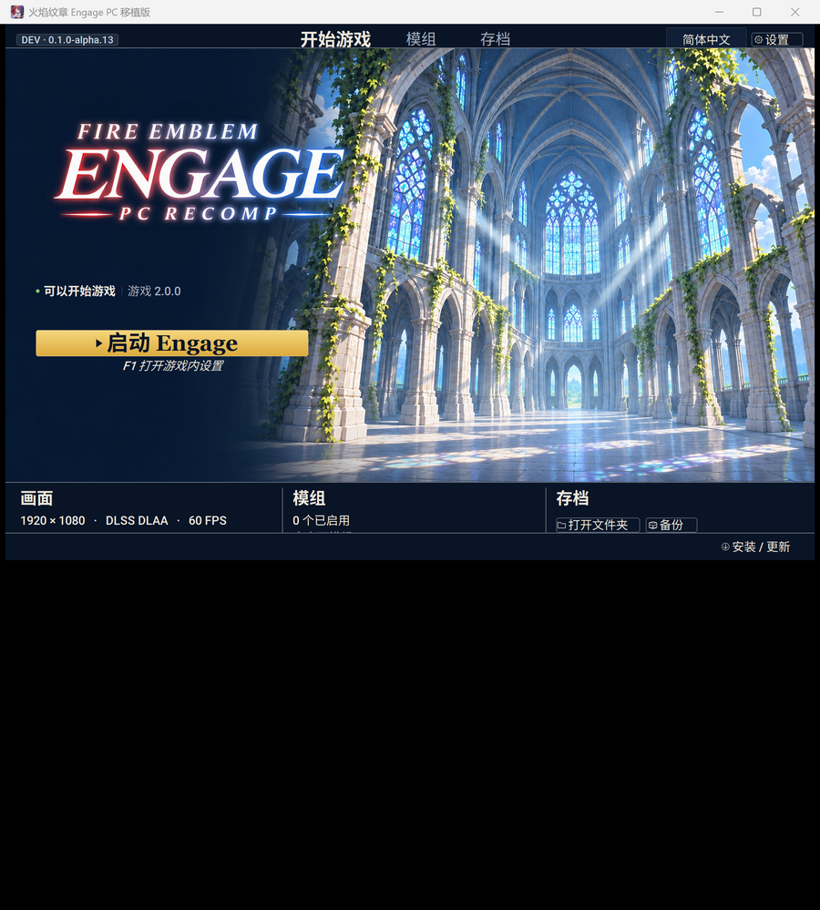
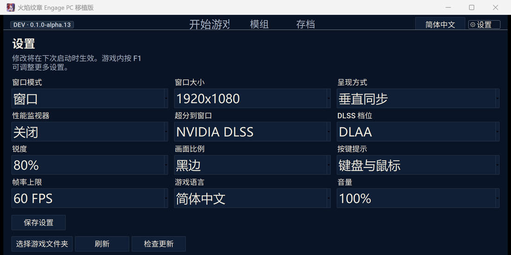

# Engage PC Recomp

A native Windows port of **Fire Emblem Engage 2.0.0** — no emulator, no Switch required.

**[Download the Windows installer](https://github.com/imalti0r/engage-pc-recomp/releases/latest)** · [Install guide](docs/installing-engage.md) · [Report a bug](https://github.com/imalti0r/engage-pc-recomp/issues/new) · [Build from source](docs/building-engage.md)

## What this is

The game's ARM64 code is translated to C and compiled for your PC, so Engage runs natively on Windows with your own copy of the game. There is no emulator layer.

**Verified on the real game:** the opening movie, the title screen, the first battle with attack cutscenes, exploration, menus, audio, keyboard and mouse, gamepad, the Chinese localisation, and 4K output with DLSS.

**Still an early alpha.** Later chapters, long sessions and every graphics effect have not been checked. Back up your saves.

## What works

- **Keyboard and mouse**, with the game's own button prompts redrawn as PC keys — white prompts on the field, blue prompts in the menus. Set **F1 → Controls → Button prompts** to follow your input device.
- **NVIDIA DLSS** at DLAA, Quality, Balanced, Performance and Ultra Performance, plus FSR 1 and bilinear scaling. The performance overlay reports the resolution you chose, the real 3D render size and the DLSS mode with its ratio.
- **Resolution up to 4K**, with a 3D render scale from 25 % to 200 % typed by hand.
- **RomFS mods**, save backups, and a launcher that checks for its own updates.
- **Interface in English and 简体中文** — the launcher and the in-game settings menu both switch language.

## Installing

1. Download `Engage-Setup-windows.zip` from [Releases](https://github.com/imalti0r/engage-pc-recomp/releases/latest) and extract it, keeping its folders together.
2. Open **Engage-Launcher.exe** and choose **Setup / Update**.
3. Select your base game, the **2.0.0** update, your keys and an extracted firmware folder. Both DLCs are optional; a combined cartridge dump (XCI) can replace the first three fields.
4. Pick an empty install folder with **40 GiB free** and click **Install Engage**.

Setup builds the game on your PC and leaves your dumps untouched. The first build takes 20–60 minutes. Afterwards use the `Engage-Launcher.exe` inside your game folder; keep its `.launcher` folder with the game.

The game is not included. You need your own base game, 2.0.0 update, keys and firmware.

## Playing

**F1** opens the in-game settings: picture, game, sound, controls, menu, advanced and mods. **Tab** opens the exploration menu in game.

- **Window size is the game resolution.** Change it in **F1 → Screen**, or in the launcher's settings. It applies on the next start — Engage allocates its display buffers once at launch.
- **DLSS mode and render scale apply immediately**, no restart.
- Saves live in `profile/save` inside your install folder; back them up from the launcher.

## Updates

The launcher checks for a newer release when it opens; **Settings → Check for updates** checks on demand. An update downloads, verifies its checksum, and restarts the launcher. Saves, mods and settings are kept.

## Building from source

See [the build guide](docs/building-engage.md). Source builds need MSYS2 UCRT64 Clang, Python 3.12 and 3.14, and the .NET SDK; the setup ZIP already contains what players need.

Settings are in `engage.ini`, logs in `logs/engage.log` next to the executable.

## Helping out

[Open an issue](https://github.com/imalti0r/engage-pc-recomp/issues/new) with your version, GPU and driver, what you were doing and how to reproduce it. Check logs for personal paths before sharing.

Please don't upload game files, keys, firmware, saves, extracted assets or generated game code. See [CONTRIBUTING.md](CONTRIBUTING.md).

## Credits and license

The port's code is under the [MIT License](LICENSE). Dependencies keep their own licenses; Nintendo game content is not covered. This is an independent fan project, not affiliated with Nintendo or Intelligent Systems. Fire Emblem and Nintendo Switch are their respective owners' trademarks.

Upstream projects and their credits are listed in [THIRD_PARTY_NOTICES.md](THIRD_PARTY_NOTICES.md).
