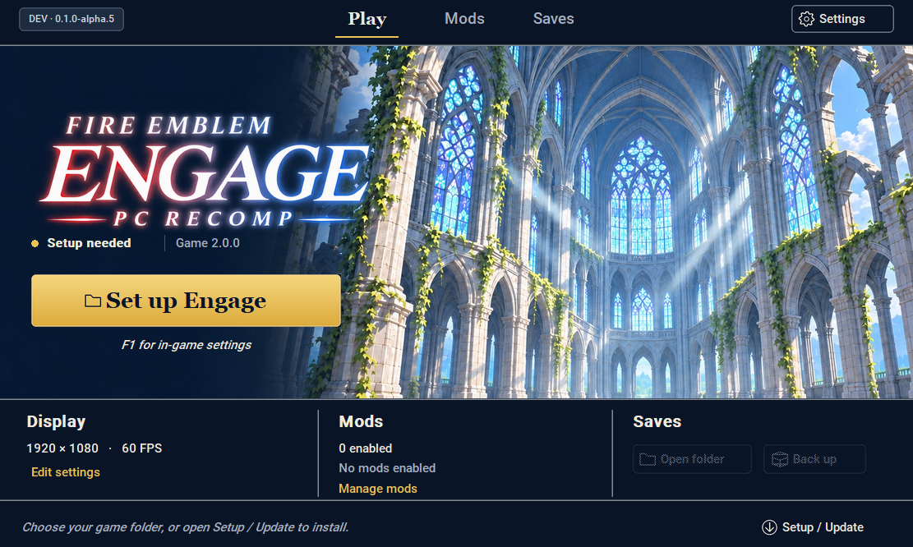

# Setting up Engage PC Recomp

[Published Windows releases](https://gitlab.com/engage-pc-recomp/engage-pc-recomp/-/releases). This guide describes the launcher-enabled development build. The published **alpha.5** download still uses **Engage-Setup.exe** and does not include the launcher, automatic updates or installed-copy handoff shown here. These features need a launcher-enabled test build until a new release is published.

This is still an alpha. Clean Windows installs and the full game remain unverified.

## What you need

| Item | What to use |
| --- | --- |
| Windows | Windows 10 or 11, 64-bit |
| CPU | x86-64-v3, including AVX2 |
| Graphics | A Vulkan 1.3 GPU with a current driver |
| Free space | At least 40 GiB on the install drive, plus space for your dumps |
| Base game | Your Engage NSP or XCI |
| Update | The Engage **2.0.0** update NSP |
| Keys | Your console's `prod.keys`; optional matching `title.keys` when package tickets are insufficient |
| Firmware | An extracted folder containing the firmware NCA files |
| Optional DLC | Expansion Pass and/or Order of Heroes Item Set NSPs |

Python, the compiler and the extractor come with setup. You don't need to install Python, Visual Studio or .NET separately.

## Install

1. Obtain a launcher-enabled Windows setup ZIP and **extract the entire ZIP**. Keep its files and folders together. For published packages, compare the ZIP with the release's `SHA256SUMS`. The older alpha.5 package uses `Engage-Setup.exe`; the steps below describe the development launcher.
2. Run **Engage-Launcher.exe**, choose **Setup / Update**, and fill in the file paths. Make sure the update is **2.0.0**. For firmware, pick the folder with the NCA files inside, not the ZIP. Add either DLC and `title.keys` if needed.
3. Pick a separate, empty install folder, like `D:\Games\Engage`, then click **Install Engage**. Allow around 20–60 minutes the first time. Your CPU and drive will affect how long it takes.
4. When setup finishes, it switches to **Engage-Launcher.exe** in your game folder. You can delete the original extracted setup folder. Use this installed launcher to play, change settings, manage mods or run **Setup / Update**. Keep its `.launcher` folder with the game. Press **F1** for in-game settings and controls. **Play Engage.cmd** is optional for troubleshooting.

Your original dumps aren't changed. The installed game icon and shared fonts come from your files. Keep the built game private—it contains game code.

Select the main game in **Base game**, the 2.0.0 patch in **Update**, and DLC only
in the optional Expansion Pass / Order of Heroes fields. Selecting a DLC NSP as
the base game stops validation and explains which field to correct. Leave
optional `title.keys` empty when it is not needed. Missing key-file paths produce
configuration errors rather than an unhandled empty-path exception.

Setup only announces that the original extracted setup folder can be deleted
after the installed launcher and tools have been copied and verified. It does
not delete that folder for you. Keep your original game dumps, firmware and keys
somewhere safe if a future rebuild needs them.

## If something goes wrong

- **File not found:** extract any outer archive first, then select the actual game file. Extract the firmware ZIP before picking its folder too.
- **Wrong update:** you need Engage **2.0.0**, title ID `0100A6301214E800`. Other updates won't work with this build.
- **DLC selected as the base game:** select the main Engage NSP/XCI in **Base game** and put the DLC in its optional field. The base title ID is `0100A6301214E000`. Combined multi-content packages are not supported by Setup's identity checks.
- **Missing title key or ticket:** firmware keys won't replace a game's title key. Use a valid dump from your console and select your matching `title.keys` if needed. Don't paste key values into an issue.
- **No Vulkan 1.3 GPU:** update your graphics driver and try again.
- **Not enough space:** choose a drive with at least 40 GiB free. Setup keeps its temporary extraction and build files on that drive.
- **Setup was interrupted:** open the same setup version, choose the same inputs and install folder, and try again. Completed steps are kept. If it says the files changed or work is missing, use a fresh folder and keep your old profile.

Click **Show log** for more detail. The error screen also gives you the log's location. Remove personal paths before sharing a log, and don't attach game files, keys, firmware, generated code, saves or a built executable.

## Saves and settings

Use the installed launcher for settings, RomFS mods and save backups. **F1** opens
additional settings in-game. Changes in the launcher are stored in the same
`engage.ini` used by the game.

Inside your install folder:

- `profile` holds your saves and player data. Back it up before experimenting.
- `engage.ini` holds your settings.
- `Engage-Launcher.exe` opens Play, Mods, Saves, Settings and Setup / Update.
- `.launcher` contains the installed launcher, Python, extractor and compiler tools. Keep it with the game.
- `.setup-work` retains extraction/build checkpoints and generated code for updates. Deleting it can require a fresh rebuild.
- `mods` contains imported RomFS mods; `save-backups` contains the ZIPs made through the launcher.
- `engage.exe` starts the game directly and finds its fonts and profile beside it. Shortcuts work from other folders too.
- `Play Engage.cmd` is an optional troubleshooting launcher that keeps an error visible if startup fails.

Setup leaves existing profiles and settings alone. The first time you see an effect, the game may pause while it builds shaders. Save/load, progress after the first battle and long sessions still need testing. See [what's working](../README.md#whats-working) for the current status.

The **Saves** page can open your save folder or create a backup ZIP while the game
is closed. Loading a save happens in the game's title menu. Backup creation does
not restore or overwrite saves.

## RomFS mods

1. Close the game and open **Mods** in the launcher.
2. Select **Import ZIP** or **Import folder** for a compatible Engage 2.0.0 RomFS mod.
3. Select its row to inspect compatibility, file counts and overlaps. Use search
   and the Enabled / Disabled / Needs attention filters to find it.
4. Enable it and start the game. After changing a mod, restart the game.

You can also toggle mods in **F1 → Mods** during gameplay, but the change applies
on the next launch. Assets already loaded in memory are not replaced live.

For manual installation, use `<game folder>/mods/<mod name>/romfs/Data/...`.
Each mod gets its own folder; do not overwrite the game's packed RomFS. When
enabled mods supply the same file, the first folder alphabetically wins. Code
patches, IPS/pchtxt and Cobalt plugins are unsupported; a mod that needs them will
not work fully even if its RomFS files load. See [all supported layouts and
limitations](launcher.md#romfs-mods).

## Updating

Open **Engage-Launcher.exe in your game folder**. It checks for newer published
releases automatically. Use **Settings → Check for updates** to check manually.
An available update shows **Update now** and **Later**. Checking does not send
your game paths or files, and an offline check does not stop Play. Unpublished
commits and PR builds do not count as published updates.

Close the game and any open setup window before choosing **Update now**. The
launcher asks for confirmation, downloads and verifies the release ZIP, checks
the new launcher, then restarts and runs the game-update pipeline. The previous
launcher package is retained. Downloads can be cancelled; a failed verification
leaves the running bundle unchanged.

Setup keeps game data, saves, settings and mods. It reuses valid extraction and
generated-code caches; a compatible runtime update can reuse `engage_game.dll`,
while a compatibility change needs a local rebuild. Leave `.launcher` and
`.setup-work` in the game folder. On completion, Setup switches to the installed
copy of the updated launcher. [Updater and recovery details](launcher.md#launcher-updates).

For an older installation without the launcher, extract a newer launcher-enabled
package and use **Setup / Update** with the existing game folder. A completed
installation normally needs no input fields for an update. Follow Setup's error
message if the original files or build cache are needed; back up `profile` before
attempting recovery from a damaged installation. Source checkouts are updated
through Git instead of the launcher updater.

If you're on alpha.2, use alpha.3 or newer to fix the F1 settings-menu crash.
