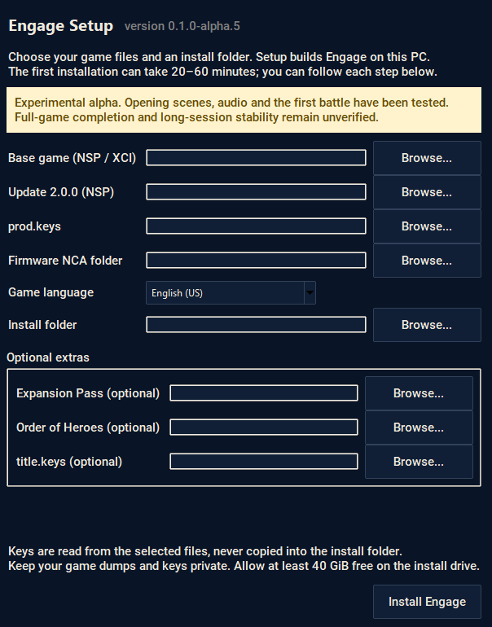

# Setting up Engage PC Recomp

[Download alpha.3 for Windows](https://github.com/veneito/engage-pc-recomp/releases/tag/engage-v0.1.0-alpha.3). This is still an alpha. Setup has worked in local testing, but clean Windows installs and the full game still need testing.

## What you need

| Item | What to use |
| --- | --- |
| Windows | Windows 10 or 11, 64-bit |
| CPU | x86-64-v3, including AVX2 |
| Graphics | A Vulkan 1.3 GPU with a current driver |
| Free space | At least 40 GiB on the install drive, plus space for your dumps |
| Base game | Your Engage NSP or XCI |
| Update | The Engage **2.0.0** update NSP |
| Keys | Your console's `prod.keys`, plus `title.keys` if the update needs it |
| Firmware | An extracted folder containing the firmware NCA files |
| Optional DLC | Expansion Pass and/or Order of Heroes Item Set NSPs |

Python, the compiler and the extractor come with setup. You don't need to install Python, Visual Studio or .NET separately.

## Install

1. Download the [Windows setup ZIP](https://github.com/veneito/engage-pc-recomp/releases/download/engage-v0.1.0-alpha.3/Engage-Setup-0.1.0-alpha.3-windows.zip) and **extract the entire ZIP**. Keep its files and folders together. Checksums are on the [release page](https://github.com/veneito/engage-pc-recomp/releases/tag/engage-v0.1.0-alpha.3).
2. Run **Engage-Setup.exe** and fill in the file paths. Make sure the update is **2.0.0**. For firmware, pick the folder with the NCA files inside, not the ZIP. Add either DLC and `title.keys` if needed.
3. Pick a separate, empty install folder, like `D:\Games\Engage`, then click **Install Engage**. Allow around 20–60 minutes the first time. Your CPU and drive will affect how long it takes.
4. When setup finishes, click **Play Engage**. After that, launch through **Play Engage.cmd** in your install folder. Press **F1** for settings and controls.

Your original dumps aren't changed. The installed game icon and shared fonts come from your files. Keep the built game private—it contains game code.

## If something goes wrong

- **File not found:** extract any outer archive first, then select the actual game file. Extract the firmware ZIP before picking its folder too.
- **Wrong update:** you need Engage **2.0.0**, title ID `0100A6301214E800`. Other updates won't work with this build.
- **Missing title key or ticket:** firmware keys won't replace a game's title key. Use a valid dump from your console and select your matching `title.keys` if needed. Don't paste key values into an issue.
- **No Vulkan 1.3 GPU:** update your graphics driver and try again.
- **Not enough space:** choose a drive with at least 40 GiB free. Setup keeps its temporary extraction and build files on that drive.
- **Setup was interrupted:** open the same setup version, choose the same inputs and install folder, and try again. Completed steps are kept. If it says the files changed or work is missing, use a fresh folder and keep your old profile.

Click **Show log** for more detail. The error screen also gives you the log's location. Remove personal paths before sharing a log, and don't attach game files, keys, firmware, generated code, saves or a built executable.

## Saves and settings

Inside your install folder:

- `profile` holds your saves and player data. Back it up before experimenting.
- `engage.ini` holds your settings.
- `Play Engage.cmd` starts the game with the graphics and font paths set.

Setup leaves existing profiles and settings alone. The first time you see an effect, the game may pause while it builds shaders. Save/load, progress after the first battle and long sessions still need testing. See [what's working](../README.md#whats-working) for the current status.

## Updating

You can resume with the **same setup version**, but updating an existing install to a different version isn't supported yet. Install the newer version into a fresh folder. Keep your old `profile` and settings backed up, and don't delete the old install until you've checked your saves in the new one.

If you're on alpha.2, use alpha.3 or newer to fix the F1 settings-menu crash.
